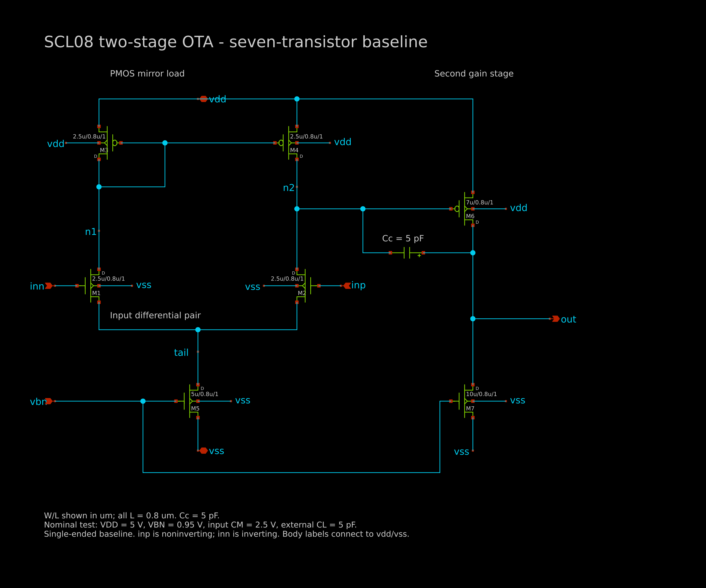

# OTA design 1 — SCL CP8D 800 nm

First-pass **single-ended, seven-transistor, two-stage Miller-compensated OTA**. Includes the rearranged xschem schematic, reusable symbol, testbenches, SPICE subcircuit, actual ngspice results and plots. This is the existing **voltage-biased baseline**, not the discussed current-reference variant or a fully differential CMFB implementation.

## Directory layout

- designs/: transistor schematic and hierarchical symbol
- tb/: native xschem AC/follower tests and SPICE AC/DC/transient/reference tests
- spice/: OTA subcircuit and configurable local PDK include template
- results/: actual logs, numerical waveforms, summary and native raw files
- results/plots/: PNG/PDF charts and schematic preview
- scripts/: model configuration, simulation and plotting utilities
- xschemrc: portable project configuration and embedded-plot support

## Configure the local PDK

The foundry cards are **not bundled**. Obtain SCL CP8D models separately, then from this directory run:

```sh
python3 scripts/configure_models.py /path/to/ngspice_models49/mos/tntp49_5v
```

The script writes spice/models.inc, which is ignored by Git. It does not modify or copy the PDK. The model file used for the saved results is identified by its hash in results/model_provenance.json.

## Simulate and plot

Requires ngspice; xschem for native schematic tests; Python/NumPy/Matplotlib for plot regeneration.

```sh
python3 scripts/run_simulations.py --xschem --plots
```

The script uses the correct working directories, regenerates numerical data and logs, and reports failures rather than claiming a successful simulation. Plotting packages can be installed in your preferred Python environment using requirements.txt.

For native xschem plots:

```sh
xschem --rcfile xschemrc tb/ota_follower_tb.sch
xschem --rcfile xschemrc tb/ota_ac_tb.sch
```

Ctrl-left-click **Run simulation + plot**. Or use Simulation → Netlist, then Simulation → Simulate and Ctrl-click **Load / refresh**. Press F outside a graph to fit the sheet. Binary raw filenames match the testbench names. All outputs go to results/.

The project-local config selects batch ngspice and fixes xschem 3.4.4's unquoted simulation working directory for paths containing spaces. It does not edit system/global settings. Native AC gain is computed from output magnitude; unwrapped phase is displayed as the negative imported phase_deg magnitude because it remains negative in this baseline.

## Nominal conditions and observed results

| Quantity | Value |
|---|---:|
| Supply / temperature | 5 V / 27 C |
| Input common mode | 2.5 V |
| External NMOS gate bias | 0.95 V |
| Output load / Miller capacitor | 5 pF / 5 pF |
| Gain at 1 Hz | 35.56794 dB |
| Unity-gain frequency | 1.554635 MHz |
| Estimated phase margin | 61.3895 degrees |
| Open-loop quiescent power | approximately 0.56 mW |
| Follower output, input 2.5 V | 2.511864 V |
| Follower output, input 2.6 V | 2.610739 V |

All lengths are 0.8 um. Widths: M1/M2/M3/M4=2.5 um, M5=5 um, M6=7 um, M7=10 um. inp is noninverting, inn is inverting; symbol pin order: inp inn out vdd vss vbn. MOS bodies are explicitly connected to their rails. The schematic netlist was checked against spice/ota7.inc. Cc connects n2 to out.



## Limits

These results were actually simulated, but they are **not optimized ASIC performance**. The current deck emits ignored-HSPICE-parameter warnings, including capacitance terms. Frequency/transient accuracy is provisional. Phase margin is estimated at the equal-input open-loop bias, not obtained from a dedicated loop-injection test at the follower/SC operating point. Only nominal conditions were tested. No actual SC noise/settling, mismatch, PVT or layout qualification is claimed. The external bias is ideal and a practical bias generator's power/startup are excluded. Requirements and future architectures discussed elsewhere are not claimed achieved here.

Model-card redistribution is deliberately separate from the authored OTA subcircuit. No environment, credentials, temporary browser tokens, notebooks, old backups or unrelated repository files are included.
