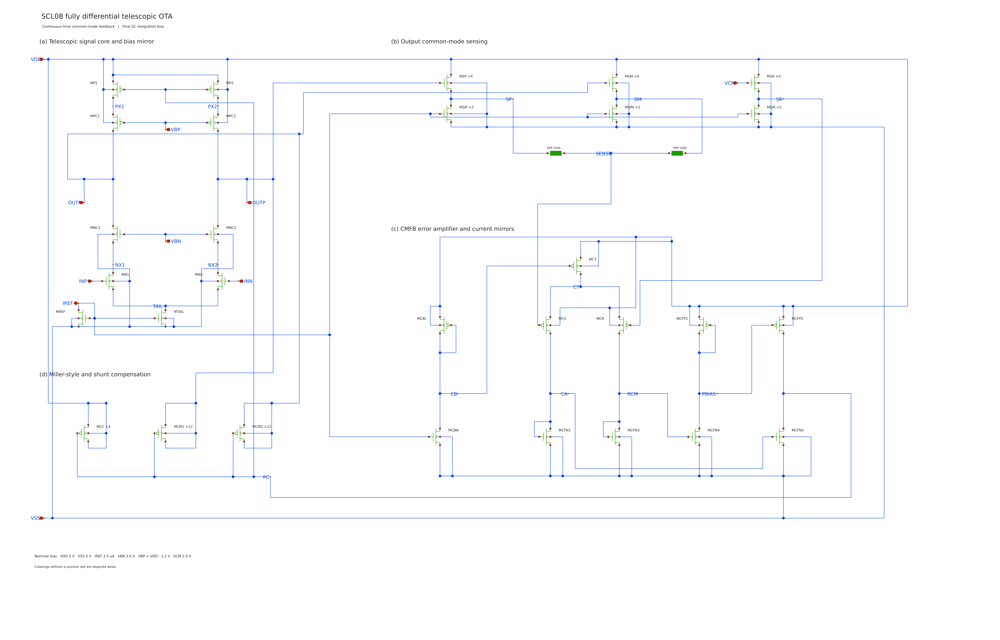

# Final OTA design

The selected CapSense OTA is a fully differential telescopic CMOS amplifier in SCL 0.8 µm with continuous-time common-mode feedback (CMFB). This release packages the 3.0 V NMOS cascode-bias revision used in the integrated SC simulation.

| Nominal setting or result | Value |
|---|---:|
| Supply / ground | 5 V / 0 V |
| Reference current into IREF | 3.5 µA |
| Output CM reference VCM | 2.5 V |
| NMOS cascode bias VBN | 3.0 V |
| PMOS cascode bias VBP | VDD − 2.2 V |
| Differential gain / unity-gain bandwidth | 87.53 dB / 1.37 MHz |
| Differential / CMFB phase margin | 89.31° / 70.74° |
| Modeled OTA power | 233 µW |

OTA figures use the extracted-capacitance model at 27 °C, typical devices, 2.5 V input common mode, and 5 pF per output. The high-gain corner screen covers settled outputs near 2.25–2.75 V per side.

- [Fully wired Xschem schematic](designs/ota_core.sch), [white-background figure (PNG)](plots/ota_wired_white.png), [vector PDF](plots/ota_wired_white.pdf), and [reusable OTA symbol](symbols/ota_cm2p5.sym).
- [GDS](layout/ota_telescopic_layout.gds) and [extracted-capacitance SPICE macro](models/ota_cm2p5_C.spice). The GDS is the locally DRC/LVS-checked CMFB revision 2 macro. The 3.0 V bias is supplied externally.
- [OTA verification report](OTA_VERIFICATION.md) and [corner data](final_ac_grid.csv). The report records the original study layout and filenames.
- [SC integration](sc_integration/) uses one shared OTA. At 10 kHz the nominal sampled differential output is 326.29 mV. All 49 tested corner and load cases completed, with about 2.05 mV worst sampled differential error and 16.6 µs worst settling. Switching glitches require late sampling.

## Schematic structure



- **A. Telescopic signal core and bias mirror.** MN1 and MN2 steer the tail current. The NMOS and PMOS cascodes raise output resistance and differential gain.
- **B. Output common-mode sensing.** Two equal 200 kΩ poly resistors average the level-shifted outputs at SENSE. A matching follower produces SR from the 2.5 V reference.
- **C. Common-mode error amplifier.** The error amplifier compares SENSE with SR. Its current mirrors drive PC, which adjusts the current supplied by both PMOS loads.
- **D. Common-mode compensation.** Two symmetric MOS capacitor banks connect PC to the outputs, and a third bank connects PC to VDD.

Open the transistor-level schematic from this directory:

```bash
xschem --rcfile "$PWD/xschemrc" designs/ota_core.sch
```

## Run the benches

Set the two paths in [models/scl08_models.inc](models/scl08_models.inc) to your installed SCL08 typical MOS card and typical RPP card. These cards are supplied by the local PDK installation.

From this directory, run the OTA bench with `(cd tb && ngspice -b ac.cir)` or `(cd tb && ngspice -b transient.cir)`. Run the integrated SC bench with `(cd sc_integration/tb && ngspice -b sc_cmfb.cir)`. The Xschem launchers are `./open_xschem.sh` for the OTA and `./sc_integration/open_xschem.sh` for the SC circuit.

The release uses engineering capacitance extraction. Full interconnect and substrate RC, noise and mismatch, and physical clock and bias generation remain open. The SC bench uses reconstructed SCL08 switches and ideal 40 pF feedback capacitors. System layout and signoff remain pending.
